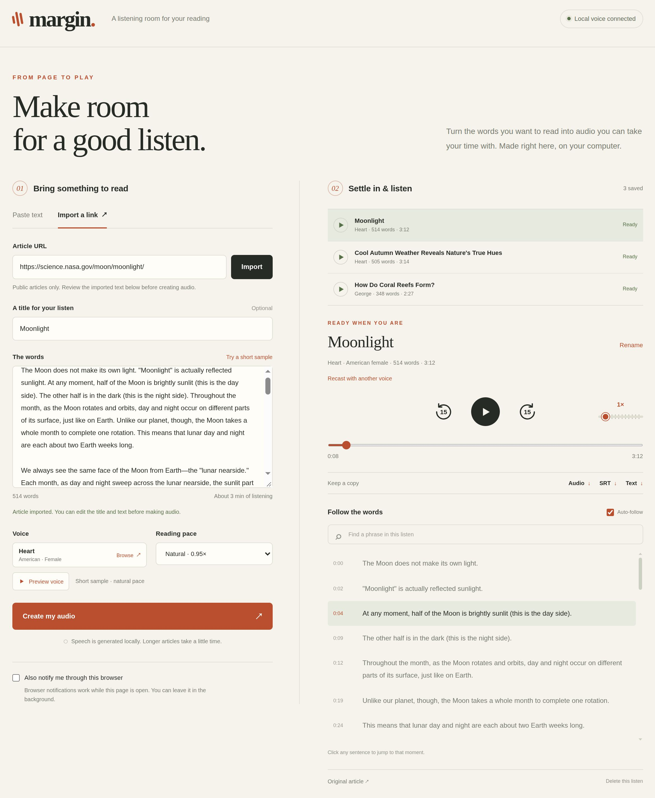
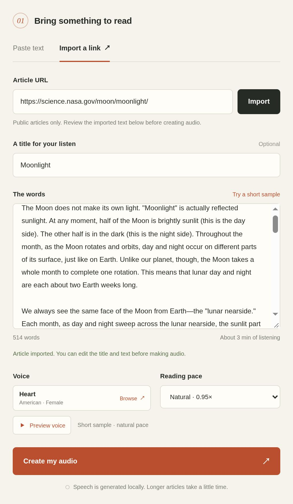
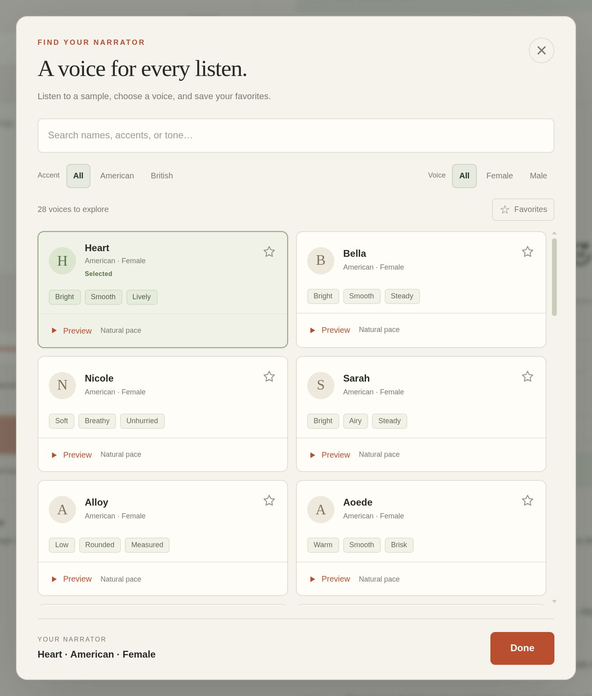
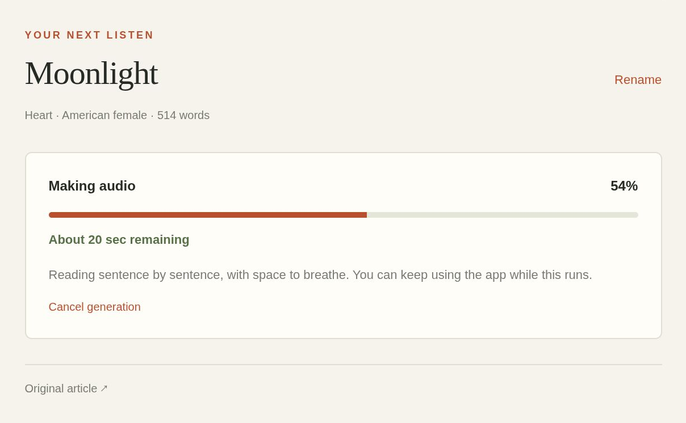
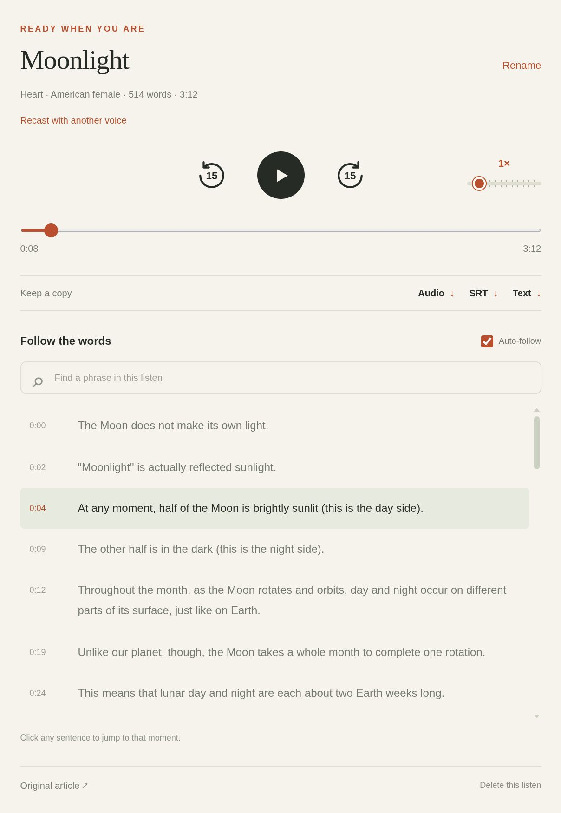

# Margin

**An automated self-hosted text-to-podcast conversion tool.**

Margin is a Go web app to convert blogposts, articles, or other pasted text into playable podcasts. It uses neural text-to-speech models locally through ONNX Runtime for voice generation. While doing so, it also generates a time-synced and searchable sentence-level transcript, which you can click through to jump around within the recording. 

It is easy to run locally through docker, and it persists a library of your generations in SQLite for ongoing use.

It supports all of Kokoro' 28 English-language narrators, simultaneous listening and async generation queuing with completion notifications and completion estimates, and includes a basic podcast client with playback, automatic "continue later" support, and speed controls.



## Local first execution and setup

To use one of our pre-built images:

[IMAGE HERE]

To build from scratch:

   ```bash
   docker compose up --build -d
   ```

During first run, it'll pull about 350Mb of Kokoro model weights on first startup, which it will cache and use locally for ongoing inference.

Default endpoint is **[localhost:8765](http://localhost:8765)**, which you can reconfigure by changing the .env. An example .env file has been provided, which includes light documentation on running this service over a tailnet.

## How it works



Start by pasting text into the editor, or finding a link to a piece of web content you want to convert to a podcast. 

The tool will pull that link, then use heuristic parsing against the provided URL to find good candidates for the primary text document body, and pull that text in for editing.

Most blogs will work directly, but more complex pages may need pre-cleaning.



Once you're done editing, choose a voice and its speed. There are 28 voices with varying qualities, and you can preview them, filter them, and save favorites as needed. Press done, and click "Generate" when you're ready.

If you're serving over SSL, you can also enable browser notifications for completed file processing.



Generation happens in the background, and you can listen to other prior generations in the background. 
a
On a 20 core Intel Core Ultra 7 265, typical generation times are about 800 words/min.

The podcasts you generate last between sessions.



Once your generations have finished, the tool include a podcast-style player with several useful quality of life features:

- Play with 15 second forward and backwards jumps,
- A speed slider with notches for speeds between 0.75x and 5x speed,
- A menu option to re-cast the podcast in a different voice, if you want a different one,
- Download buttons for the original text, the finished audio.wav file, and a timestamped .SRT file
- A sentence-level searchable transcript of the full podcast, which you can click in to jump to the associated line and timestamp

Additional documentation written by an agent is available in  **[full guide](docs/guide.md)** for Tailscale, native setup, backups, configuration, and development.

Application code is released under **[MIT](LICENSE)** Licensing. Models and dependencies retain their own licenses, see [third-party notices](THIRD_PARTY_NOTICES.md).